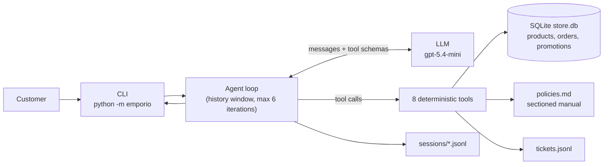

# Empório da Música: customer-support agent

A text-based support agent for a (fictional) musical instruments store in Campo Grande/MS. It answers in Portuguese, in the tone of the store's own service guidelines, and decides on every message whether it needs live data (catalog, prices, stock, promotions, orders), the store policies (exchanges, payment, hours, shipping), or neither (small talk, out-of-scope requests).

- Python 3.11+, command-line chat, the official `openai` SDK and a hand-written tool-calling loop (no agent framework).
- Data lives in SQLite built from the supplied CSVs; the policies manual is converted to sectioned Markdown.
- Anything that must be exact (prices, discounts, installments, deadlines, shipping, who may see an order) is computed by deterministic Python tools, never by the model.
- 251 offline tests; 21 scenario evals against the real model (57 of 63 runs passed, see [Evaluation](#5-evaluation)).

A short taste (full transcripts in [`examples/`](examples/)):

```text
Cliente:   Quanto custa o Takamine GD20?
Atendente: O Takamine GD20 Dreadnought Natural custa R$ 2.199,00 e está disponível.
           Se quiser, posso te passar as especificações dele também.
           [tool called: get_product(name="Takamine GD20")]
```

## Contents

1. [Quick start](#1-quick-start) · 2. [Architecture](#2-architecture) · 3. [Technical decisions](#3-technical-decisions) · 4. [Example conversations](#4-example-conversations) · 5. [Evaluation](#5-evaluation) · 6. [Assumptions](#6-assumptions) · 7. [Known limitations and next steps](#7-known-limitations-and-what-i-would-do-with-more-time) · 8. [AI coding assistants](#8-ai-coding-assistants) · 9. [Project structure](#9-project-structure-and-data-handling)

## 1. Quick start

Requirements: Python 3.11 or newer (developed and tested on 3.12, on Windows) and an OpenAI API key (or any OpenAI-compatible endpoint).

```bash
# 1. environment
python -m venv .venv
source .venv/bin/activate          # Linux/macOS
# .venv\Scripts\Activate.ps1       # Windows PowerShell
# source .venv/Scripts/activate    # Windows Git Bash

pip install -e ".[dev]"            # keep -e: the code finds data/ relative to the repository
                                   # exact versions are also pinned in requirements.txt
# On Windows, if PowerShell refuses to run Activate.ps1:
#   Set-ExecutionPolicy -Scope Process -ExecutionPolicy Bypass

# 2. configuration
cp .env.example .env               # Windows: copy .env.example .env
# edit .env and set OPENAI_API_KEY
```

| Variable | Meaning |
|---|---|
| `OPENAI_API_KEY` | Your key (required). `.env` is git-ignored. |
| `OPENAI_MODEL` | Chat model. Prefilled with `gpt-5.4-mini`. |
| `OPENAI_BASE_URL` | Optional. Endpoint of an OpenAI-compatible provider; empty means OpenAI. |
| `EMPORIO_NOW` | Optional. Fixed "current time" (ISO 8601, store time), e.g. `2026-03-25T10:00`; empty means the real clock. |
| `OPENAI_PRICE_INPUT_PER_1M`, `OPENAI_PRICE_OUTPUT_PER_1M` | Optional. USD per 1M tokens (prefilled for `gpt-5.4-mini`), used only for cost estimates. |

The SQLite database is built automatically from `data/raw/` the first time a tool needs it. It is not rebuilt automatically afterwards, so after pulling changes to `build_db.py` run `python -m emporio.build_db` to rebuild it.

### Chat

```bash
python -m emporio                          # new conversation
python -m emporio --trace                  # also show which tools were called, with arguments
python -m emporio --now 2026-03-25T10:00   # simulate the store clock (Wednesday 10:00, open)
python -m emporio --session abc123         # resume a saved conversation (data/runtime/sessions/)
```

Inside the chat: `/reset` starts over, `/sair` quits (Ctrl+C at the prompt also exits cleanly; pressing it while the agent is answering ends the program with a traceback). Without a key or model the program prints a clear configuration message and exits.

### Tests

Offline, no key needed, about 5 seconds.

```bash
pytest
```

### Evals

These call the real model. One full execution of the 21 scenarios costs about US$ 0.09 with `gpt-5.4-mini`. The clock is fixed at 2026-03-25 10:00 by the scenarios file unless `EMPORIO_NOW` is set.

```bash
python -m emporio.evals                                                    # all scenarios, one execution
python -m emporio.evals --only produto_esgotado_96                         # a single scenario
```

### Re-recording the example conversations

About US$ 0.02 each.

```bash
python -m emporio.demo examples/scripts/01-catalogo.json                   # writes examples/01-catalogo.md
```

## 2. Architecture



On each turn the user message goes to the model with the tool schemas. If the model asks for tools, the loop runs them (several at once if requested), returns the JSON results and asks again. This repeats until the model answers in plain text, or until the iteration limit produces a polite fallback. A failing tool becomes an error result the model can react to, never an exception. If the model API fails, the turn is rolled back so history stays consistent.

| Tool | What it does |
|---|---|
| `search_products` | Catalog search with text, category, price, string-type and promotion filters; hides unavailable items; reports total count and truncation; suggests alternatives; recognises accessory requests. |
| `get_product` | One product by id or approximate name: price, promotion, availability, specs, alternatives for unavailable items. |
| `get_order_status` | Order lookup after verifying e-mail/phone; delay flag; return, exchange and warranty deadlines for delivered orders. |
| `calculate_payment` | PIX discount, installments (minimums per range), combined payment methods; all arithmetic in integer cents. |
| `estimate_shipping` | Free/flat shipping in Campo Grande, carrier options elsewhere, special freight for large instruments. |
| `get_store_hours` | Open/closed now and next opening, with the store time zone and national holidays. |
| `search_policies` | Keyword search over the sectioned policies manual; adds guidance notes (official contact, defect and warranty rule). |
| `create_ticket` | Hands a complaint or claim to a human (promises a reply within 24 business hours). |

## 3. Technical decisions

### Agent approach: native tool calling, hand-written loop

*Considered:* vector RAG over everything, an SQL-writing agent, ReAct prompting, and frameworks (LangChain, LlamaIndex, CrewAI).
*Why this:* the task is "know when to look up data vs. policy", which is exactly what function calling expresses. Most questions need exact structured answers (price, stock, order status), and retrieving text chunks is the wrong tool for that. An SQL agent would let the model write queries over customer data and own the business rules. A framework would hide a loop that fits in one file of about 110 lines and that I wanted to control (history window, rollback, limits, tracing). The manual is small enough for simple retrieval (next point), so the design is a hybrid: tools for data, keyword retrieval for text.

### Model and provider: `gpt-5.4-mini` via Chat Completions

*Considered:* cheaper small models and older mini models, local models.
*Why:* it supports tool calling, runs without extra reasoning by default (predictable cost and latency) and costs US$ 0.75 / 4.50 per 1M input/output tokens. A whole 21-scenario eval costs about US$ 0.09. My first shortlist included models that OpenAI's documentation marks as deprecated, so I dropped them. The request only sends `model`, `messages` and `tools` (no sampling or reasoning parameters), and `OPENAI_BASE_URL` lets any OpenAI-compatible provider be used. The client retries transient errors (429, 5xx, timeouts) twice with backoff and never retries authentication errors.

### Policies: sectioned Markdown plus keyword search, no embeddings

The manual is about eight pages (26 numbered sections). I rewrote the PDF as Markdown with one numbered section per heading, and a script checks the Markdown against the PDF word by word. Retrieval is a small keyword scorer (accent and plural insensitive, title matches weigh more, a few synonyms) that returns up to three sections. *Why not embeddings:* at this size they add a dependency, a cost and an opaque ranking for no accuracy gain, and a lexical miss is easy to debug in `--trace`. *When I would switch:* if the manual grows to dozens of pages, if paraphrase misses show up in the evals, or if the customer-facing language mix grows. Then I would use hybrid keyword + embedding retrieval.

### Data handling: SQLite, integer cents, derived flags, raw files untouched

The CSVs are loaded into SQLite and money is stored as integer cents. Problems found in the data become derived columns and flags instead of edits (`availability`, `description_reliable`, `total_matches_list`, normalised phone/e-mail). `data/raw/` is never modified and its checksums are recorded. Examples of what the quality pass found: 7 products whose description contradicts their name or specs (withheld from answers), a product listed as "coming soon" with stock, orders 3 and 20 whose total does not match price times quantity, three credit orders that break the installment minimum, and two conflicting contact numbers in the manual. Full evidence and decisions are in [`docs/data_quality.md`](docs/data_quality.md); file mapping and checksums are in [`docs/raw_data.md`](docs/raw_data.md).

### The model never calculates

Prices, PIX discounts, installments, shipping, deadlines and "is the store open" come from tools that return both numbers and ready-to-print text (`R$ 2.199,00`). A concrete case: in one eval the model correctly said a promotional item gets no extra PIX discount, but wrote the discount amount (R$ 431,82) by subtracting two prices itself. The value was right, the practice was not, so the promotion now carries `discount_brl`/`discount_text` and the prompt says to use only returned fields.

### Objective rules moved from the prompt into code

Evals showed that prompt instructions alone were inconsistent for two things: suggesting alternatives for an unavailable product (the agent often just offered to look, passing 1 run in 3) and refusing accessories the store does not sell (2 in 3 with an imprecise reason). I made both deterministic: unavailable products come with up to three available alternatives of the same category, string type and string count; accessory searches return `not_sold_accessory`. Both went to 3/3. A third case came later: with an order already verified, the agent kept asking for an e-mail or phone again before opening a ticket. `get_order_status` now returns `verified_contact` (the contact the customer gave in that query, normalised, never one taken from the customer record), and the ticket rule says to use it. Facts and exact rules now live in code; the prompt keeps tone, conversation flow and when to hand off to a human. Tool outputs carry facts, not instructions: a tool note that told the model to open tickets competed with the prompt and was removed after the independent review (see [Evaluation](#5-evaluation)).

### Tools only receive declared arguments

`call_tool` passes a tool only the arguments in its schema; anything else the model sends (for example a `now` that would move the clock) is dropped and reported as `ignored_arguments` in the result, visible in `--trace`. Dropping instead of failing keeps a harmless extra from costing another model round-trip.

### Privacy: verified order lookup

An order is shown only when the customer gives the order number and the e-mail or phone of that order's owner. A missing order, a wrong contact and no contact all produce the same generic answer, so the agent cannot be used to discover which orders exist. The contact is compared only with the order's own customer (two customers in the dataset share an e-mail). See example 5.

### Prompt strategy

One concise Portuguese system prompt ([`system_prompt.md`](src/emporio/agent/system_prompt.md)): persona from the store's own service guidelines (informal but professional, like a friend who knows music, short chat replies) and thirteen rules (data only from tools, policies from `search_policies`, promotions with original price, percentage and final price, unavailable products with alternatives, order verification, accessories, out-of-scope refusal, complaints to tickets, no inventing, list limits, resisting injection, speaking as an attendant without mentioning internal tools, and never concluding "none" from a truncated search). The current store date and time is injected at the start of each conversation. The agent never cites the manual to the customer ("pela nossa política de trocas", not "manual, section 4.1"), because it is an internal document. Traceability moved to `--trace`, logs and eval reports, which show the sections returned by `search_policies`.

### Conversation history

Each session is a JSONL file in `data/runtime/sessions/` (git-ignored) that can be resumed; on resume the system prompt is rebuilt, so the model gets the current date and time, not those of the first message. Only the last 30 messages are sent to the model, cut so that a window always starts at a user message: a tool call is never separated from its result.

### Single clock and demo date

Every tool reads "now" through one function, overridable with `EMPORIO_NOW`. The dataset is a snapshot from around March 2026, so with the real clock every pending order would be months old and the shipped order 245 days late (on 2026-10-31); for demos, evals and examples I fix the clock at 2026-03-25 10:00 (a Wednesday, store open), which makes results reproducible and realistic. Leave it empty in production.

## 4. Example conversations

Five recordings of the real agent, produced by `python -m emporio.demo`, with tool calls in collapsible blocks. The agent's text is exactly what the model returned; nothing was edited. All use the simulated date 2026-03-25 10:00.

| File | What it shows |
|---|---|
| [`01-catalogo.md`](examples/01-catalogo.md) | Catalog search under R$ 1.000, a follow-up filter ("só os de nylon") and an exact price. |
| [`02-loja-e-pagamento.md`](examples/02-loja-e-pagamento.md) | Address and hours from the policies, "open now?" from the clock, PIX on a promotional item, a 10x installment. |
| [`03-devolucao-e-garantia.md`](examples/03-devolucao-e-garantia.md) | **The non-trivial case.** Withdrawal question, then a verified order (order 7) with computed deadlines, then a defect report that ends in a ticket. |
| [`04-esgotado-e-promocao.md`](examples/04-esgotado-e-promocao.md) | Expired promotion on an out-of-stock item with alternatives, "which guitars are on promotion?" (filtered search), an active promotion with original price, percentage and final price. |
| [`05-limites-e-seguranca.md`](examples/05-limites-e-seguranca.md) | Accessories, out-of-scope request, a "ignore your rules" injection and a wrong e-mail on an order (nothing leaks). |

Each file is a single, unedited run (no picking the best of several takes), with one documented exception. All five were re-recorded after the independent review, and example 4 was recorded twice because the first take broke the store's own rule for an out-of-stock product: it only *offered* alternatives instead of showing them. The second take is published. Example 3 was re-recorded once more, in a single take, after the verified-contact fix described in [Technical decisions](#3-technical-decisions). Two imperfections are left as recorded. In example 1 the agent lists five nylon guitars, above its own limit of four. In example 2 it says "10 parcelas de R$ 196,72" although the tool's schedule ends with two installments of R$ 196,71.

Example 4 has a story behind it. My first recording had the agent answer that no guitar was on promotion, because the search results were truncated at 20 items sorted by price and the Crafter HT-100 (18% off) was cut off. I fixed the tool (a promotion filter, the total count and a truncation warning) and the prompt, validated the change with the evals and re-recorded the example. Example 2 was re-recorded in the same pass because the agent had mentioned its internal tools to the customer.

## 5. Evaluation

There are 21 scenarios in [`evals/scenarios.json`](evals/scenarios.json), each checked automatically: expected tools, phrases that must or must not appear, list size, and global bans (no mention of the internal manual, no mention of internal tools ("ferramenta"), no invented "priority", no warranty described as starting after the exchange window). The final validation ran every scenario three times with the clock fixed: **57 of 63 runs passed (90%)**. One scenario still fails: with a verified order and a defect, the agent no longer asks for a contact again, but it offers the ticket instead of opening it (0/3; details in the evaluation page). Over all rounds the evaluation cost about US$ 1.81 in total. [`docs/evaluation.md`](docs/evaluation.md) has each round, what it revealed and what changed (including problems found by reading the replies that the automatic checks missed), and the remaining failures with their causes.

## 6. Assumptions

The brief leaves some things open, so I documented each interpretation. The evidence is in [`docs/data_quality.md`](docs/data_quality.md), and the choices are isolated in constants so they are easy to change.

| # | Assumption | Why |
|---|---|---|
| S1 | The official contact is (67) 3341-4444; the other number in the manual is never quoted. | Appears in two of three mentions, including the company data table. |
| S2 | The e-mail is written without accent (`contato@emporiodamusica.com.br`). | Domains do not carry accents in practice. |
| S3 | The payment table's "up to 12x, minimum R$ 100" is read as the cap, and the installment rules by range win. | The more specific rule wins. |
| S4 | "Up to 3x with no minimum, except below R$ 50" means each installment must be at least R$ 50. | Conservative reading, consistent with the R$ 80 and R$ 100 ranges. |
| S5 | The PIX 5% is applied line by line, only to items without an active promotion. | Promotions are not cumulative. |
| S6 | "Above" means strictly greater: exactly R$ 500 pays shipping, exactly R$ 2.000 cannot combine payment methods. | Literal reading; base is the merchandise value after promotions. |
| S7 | The "metropolitan region" is only Campo Grande (written with or without accents, punctuation or the "MS" state). | The manual does not define it; other customers live in far cities. |
| S8 | An active promotion is a row with `is_active = 1`; if there were several, the largest percentage wins. | The table has no dates. |
| S9 | Order totals exclude shipping. | 18 of 20 orders match the merchandise exactly. |
| S10 | For defects the agent quotes the 30-day exchange (from purchase) and the 90-day legal warranty (from receipt) as running in parallel, promises no outcome and opens a ticket. | The two manual sections otherwise read as contradictory. |
| S11 | The catalog wins over the manual's "more than 300 instruments": empty categories are reported as "no items listed now" with an offer of a ticket. | Avoid misleading advertising. |
| S12 | A product description that contradicts its name or specs is never used as fact. | Name and structured fields are the source of truth. |
| S13 | The store opens at the start minute and closes at the closing minute (exclusive). | The manual does not say what happens at the exact minute. |
| S14 | Price filters use the current price (promotion applied). | It is what the customer pays. |
| S15 | `pending` and `confirmed` orders are never called late; only `shipped` orders past their estimate are. | The manual defines no processing deadline. |
| S16 | The receipt date is approximated by the order's estimated delivery date, and every order in the system counts as a remote (online) purchase. | The data has no real receipt date or sales channel. Return windows: withdrawal and preference exchange 7 days from receipt, defect exchange 30 days from purchase, legal warranty 90 days from receipt. |
| S17 | "7 strings" is read from the product name when suggesting alternatives. | It is not a structured spec; the name is the source of truth. |
| S18 | Accessory requests are recognised by a fixed word list (strings, cables, picks, pedals, amplifiers, cases, covers, bags, tuners, stands, drumsticks, straps), singular or plural, ignoring uses like "7 cordas" or "with built-in tuner". | The store sells instruments only. |
| S19 | Holidays are the fixed national list for 2025-2026. | The manual lists none. |
| S20 | In-store purchases are not in the data; the agent explains from the policy text that withdrawal rights apply to online purchases. | The manual states the withdrawal right for online purchases. |

## 7. Known limitations and what I would do with more time

### Known limitations

- Defect with a verified order: the agent explains the deadlines and no longer asks for the contact again, but it offers the ticket and waits for a yes instead of opening it (the defect-with-order scenario fails 3 of 3). Details in [`docs/evaluation.md`](docs/evaluation.md).
- Duplicate tickets after an API failure: if the model API fails after `create_ticket` ran in the same turn, the turn is rolled back but the ticket stays in the queue. The customer repeats the message and a second ticket can be opened. Future fix: idempotent tickets (a key per conversation and claim).
- Alternatives do not distinguish acoustic from electro-acoustic guitars.
- Order data is shown as stored (statuses months old, no unit prices), and the receipt date is approximated (S16).
- Retrieval is lexical: paraphrases without shared words can miss.
- Evaluation used one model, one fixed date and three runs per scenario: indicative, not statistical.
- It is a CLI prototype: no real WhatsApp channel and the human hand-off is a JSONL file.
- Personal data at rest: sessions and tickets keep e-mails, phones and order details in plain JSONL with no retention policy, and order verification has no attempt limit.
- Holidays are a fixed national list that ends in 2026; state and municipal holidays are not covered.
- The data in `data/raw/` is the fictional dataset supplied for the challenge (customers included).

### With more time, in priority order

1. Idempotent tickets (a key per conversation and claim).
2. Real delivery dates and sales channel in the data; real WhatsApp integration with a proper human hand-off and ticket queue.
3. Stronger evals: LLM-as-judge for tone, more executions per scenario, adversarial and multi-turn injection cases.
4. Observability: structured logs, cost and latency per conversation, tracing of tool use.
5. A small API (FastAPI) and deployment, prompt caching and a fallback model.
6. CI running the offline tests (and a nightly eval).
7. Embedding or hybrid retrieval if the manual grows; acoustic/electro-acoustic awareness in the alternatives.

## 8. AI coding assistants

I built this with Claude in two roles.

- Planning and review: Claude Opus, in the Claude app, acted as my technical lead. It read the brief and the data with me, proposed the architecture, split the work into stages and wrote the instructions for each stage. It reviewed every report, transcript and diff, and pushed back on results (for example, by reading the eval answers by hand in addition to the automatic checks).
- Implementation: Claude Code (Claude Sonnet 5.5) implemented each stage on my machine under explicit rules: small commits, failing tests first, no push, never read the `.env`, never edit `data/raw`. The commits carry a `Co-Authored-By` line.
- Independent review: before publishing, I ran a read-only review of the whole repository with Claude Opus in a fresh session, with no context from the build. It found real defects, including a tool note that pushed the agent to open tickets, a city-name normalisation bug in shipping and tool arguments outside the schema being accepted. I triaged the findings, fixed the real ones with tests, re-ran the evals and re-recorded the examples.
- **My part:** I set the goal and the limits: deadline, budget and what could be public. I handled the hands-on setup: I created the OpenAI account and API key with a spending limit, organised the challenge files (keeping the brief out of the repository) and created the GitHub repository. I ran every stage in Claude Code, read the reports and the recorded conversations, and decided what moved forward and what went back for rework. Running an independent review with a different model before publishing was my idea, and it found defects we had been blaming on the model. Technical decisions were proposed during planning; I asked why whenever something was not clear to me, and I approved the final calls.

Five real moments of the process:

1. The first model choice was outdated. Claude Code's first shortlist favoured `gpt-4.1-mini`. Checking OpenAI's model pages showed that it (and `gpt-5-mini`) is marked as deprecated, so I chose `gpt-5.4-mini`, which is current, supports tool calling and runs without extra reasoning by default.
2. A bug found by reasoning about the setup. The app crashed with an invalid-URL error when `OPENAI_BASE_URL` was left empty, exactly as in `.env.example`. We first guessed a malformed value; the real cause was that an empty variable is not an absent one for the SDK. It was reproduced with a failing test, then fixed in the configuration and the client.
3. Reversing an earlier instruction. The agent first cited "the manual, section X". Once it was clear the manual is an internal document, we changed the rule: the agent now explains the policy in its own words and the traceability moved to the tool traces and eval reports.
4. Evals changed the architecture. Reading the replies showed the prompt was inconsistent for alternatives, accessories and discount amounts; those rules moved into tools, and the pass rate went from 52/57 to 56/60 while the checks got stricter.
5. A recorded example exposed a bug the evals missed. The first recording of example 4 had the agent claim there were no promotions on guitars: the search had been truncated and the agent concluded "none" from an incomplete list. The fix went into the tool (promotion filter, total count, truncation warning) rather than only into the prompt.

## 9. Project structure and data handling

```text
data/raw/            supplied CSVs and the policies PDF, never edited (checksums in docs/raw_data.md)
data/processed/      policies.md, the manual as numbered Markdown sections
data/runtime/        generated and git-ignored: store.db, sessions, tickets, eval reports
src/emporio/
  build_db.py        CSV -> SQLite, derived columns and flags
  tools/             the 8 tools (+ registry and OpenAI schemas in __init__.py)
  agent/             config, LLM client, system prompt, loop, sessions, CLI
  evals/             scenario runner (python -m emporio.evals)
  demo.py            conversation recorder (python -m emporio.demo)
evals/scenarios.json 21 eval scenarios
examples/            5 recorded conversations and their scripts
docs/                data_quality.md, tools.md, agent.md, evaluation.md, raw_data.md
scripts/             quality_checks.py (evidence for the data report), verify_policies.py
tests/               offline tests with a scripted fake model
```

How the data was treated, with evidence and the decision for each finding, is in [`docs/data_quality.md`](docs/data_quality.md). The tools and the assumptions encoded in them are in [`docs/tools.md`](docs/tools.md). Configuration and request compatibility are in [`docs/agent.md`](docs/agent.md).
